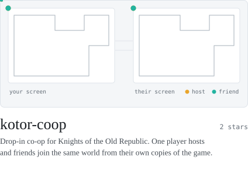

<picture><source media="(prefers-color-scheme: dark)" srcset="https://raw.githubusercontent.com/ChristopherVR/ChristopherVR/output/hero-dark.svg"></picture>

<picture><source media="(prefers-color-scheme: dark)" srcset="https://raw.githubusercontent.com/ChristopherVR/ChristopherVR/output/now-dark.svg"></picture>

<a href="https://christophervr.github.io/ooxml/"><picture><source media="(prefers-color-scheme: dark)" srcset="https://raw.githubusercontent.com/ChristopherVR/ChristopherVR/output/ooxml-dark.svg"></picture></a>

<!-- cards:start (written by scripts/build.mjs from the pinned repositories) -->

<a href="https://christophervr.github.io/AbioticEditor/app/"><picture><source media="(prefers-color-scheme: dark)" srcset="https://raw.githubusercontent.com/ChristopherVR/ChristopherVR/output/card-abioticeditor-dark.svg"></picture></a>
<a href="https://christophervr.github.io/emf-converter/"><picture><source media="(prefers-color-scheme: dark)" srcset="https://raw.githubusercontent.com/ChristopherVR/ChristopherVR/output/card-emf-converter-dark.svg"></picture></a>

<a href="https://christophervr.github.io/kotor-mod-manager/"><picture><source media="(prefers-color-scheme: dark)" srcset="https://raw.githubusercontent.com/ChristopherVR/ChristopherVR/output/card-kotor-mod-manager-dark.svg"></picture></a>
<a href="https://christophervr.github.io/Drakan2PC/"><picture><source media="(prefers-color-scheme: dark)" srcset="https://raw.githubusercontent.com/ChristopherVR/ChristopherVR/output/card-drakan2pc-dark.svg"></picture></a>

<a href="https://christophervr.github.io/kotor-coop/"><picture><source media="(prefers-color-scheme: dark)" srcset="https://raw.githubusercontent.com/ChristopherVR/ChristopherVR/output/card-kotor-coop-dark.svg"></picture></a>
<a href="https://christophervr.github.io/mtx-decompressor/"><picture><source media="(prefers-color-scheme: dark)" srcset="https://raw.githubusercontent.com/ChristopherVR/ChristopherVR/output/card-mtx-decompressor-dark.svg"></picture></a>

<!-- cards:end -->

<picture><source media="(prefers-color-scheme: dark)" srcset="https://raw.githubusercontent.com/ChristopherVR/ChristopherVR/output/overview-dark.svg"></picture>

<picture><source media="(prefers-color-scheme: dark)" srcset="https://raw.githubusercontent.com/ChristopherVR/ChristopherVR/output/footer-dark.svg"></picture>
